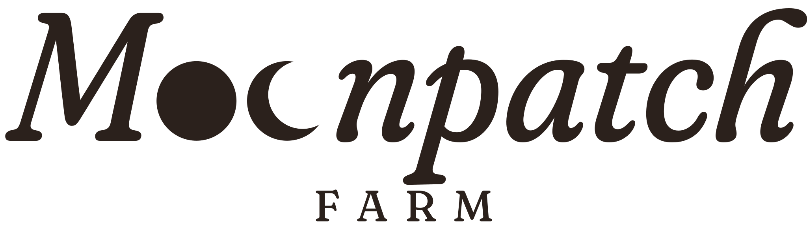
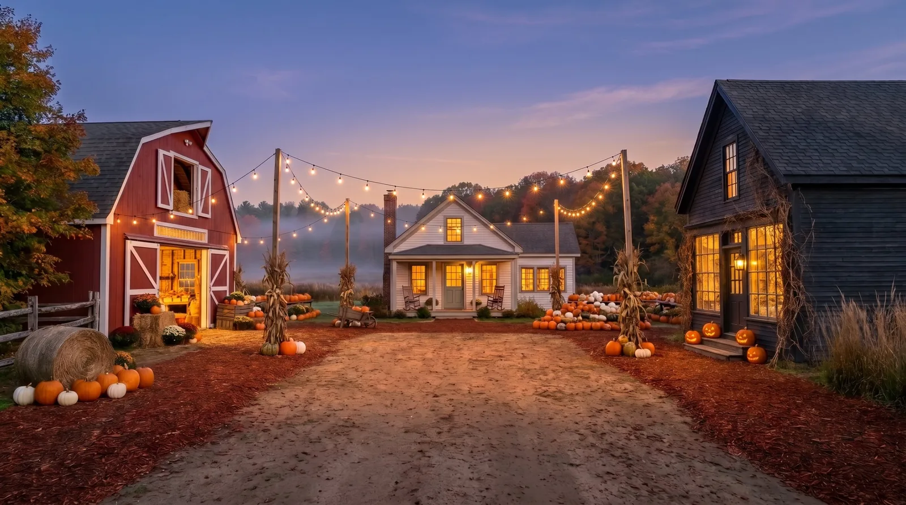

<p align="center">
  <a href="https://moonpatch.vercel.app/en">
    <picture>
      <source media="(prefers-color-scheme: dark)" srcset=".github/readme/wordmark-light.svg">
      
    </picture>
  </a>
</p>

<p align="center">
  <strong>A concept site by <a href="https://www.govodigital.com">GOVO DIGITAL</a></strong><br>
  <a href="https://moonpatch.vercel.app/en">moonpatch.vercel.app</a> · <a href="https://moonpatch.vercel.app/pl">Polish version</a>
</p>



Moonpatch Farm is a fictional autumn pumpkin farm told as a site you walk through. Scrolling swings the gate open and carries the camera through the arch onto the square, where golden hour fades into dusk. A signpost leads into three buildings, each entered with a camera move through its door; inside, products wait on recipe cards and kraft tags, go into a wheelbarrow, and things that can't be shipped are reserved for a visit and printed on a Farm Pass. It is a demo shop with no payments, in English and Polish. All plates, layers and graphics on the site are generated and edited by me.

## Highlights

- **WebGL2 engine in a worker, no 3D library.** The gate, the square, the rooms and every camera move are drawn by one hand-written WebGL2 engine on an `OffscreenCanvas` in a Web Worker: decoding, texture uploads and frames stay off the main thread, the page only sends scroll progress. Without `OffscreenCanvas` the same engine runs on the page; without WebGL2 (checked without creating a test context) the site stays on its still plates. The first frame is the gate photograph itself, and the gate's layers are cut from it by a build script so that at rest they land on the poster's exact pixels, so the canvas takes over without a visible swap. Narrow portrait screens get a tall version of the plate mapped onto the same layers.
- **A gate on hinges.** The leaves are 3D planes swinging about 100° on their posts, with a contact shadow on the road that turns with each leaf and shading that darkens as it turns away from the sun. The opening follows the scroll through a damped, speed-limited spring, so a fast flick catches up instead of jumping. Past a threshold a fixed-length camera move flies through the arch with parallax and a directional blur taken from the camera's speed; scrolling back above the threshold plays it in reverse.
- **Dusk, a light at a time.** The golden-hour and dusk plates are blended on one shared grain (dusk's colour carried onto golden's detail by a guided filter, so the picture never swims mid-fade). Every string light, lamp and window is its own mask taken from the difference between the plates, and they switch on one by one, each with its own soft bloom.
- **Camera moves into the rooms.** A quick push in on the door that builds speed, a cut to the room at the top of that speed, and the room settling as the camera brakes. The whole move is one number, so it can be stopped and turned back anywhere, through the cut as well; going from one room to another passes through the square. Every room and the notice board are server-rendered at their own address (Polish addresses in Polish), and the browser's back and forward buttons follow the address.
- **Wheelbarrow and Farm Pass.** The basket is a Zustand store persisted to `localStorage` and validated with Zod when it is read back. It splits into things shipped to you and things waiting at the farm, with a visit day picked from the Fridays to Sundays of October. Checkout makes a Farm Pass in HTML and CSS from the basket, and "Save ticket" redraws it onto a canvas and saves it as a PNG. There is no payment code anywhere.
- **Accessible, and quiet by default.** Everything works from the keyboard, dialogs trap focus and the scene behind them is inert, and with `prefers-reduced-motion` scenes cut or crossfade instead of moving. Sound plays through the Web Audio API, is off until switched on, loads only then, and crossfades a bed of sound per room.

**Stack:** Next.js 16 (App Router), React 19, TypeScript, Tailwind CSS 4, Lenis, Zustand, Zod, WebGL2, Web Audio, sharp, Vitest, Playwright, Vercel.

## Lighthouse

Measured on production (`https://moonpatch.vercel.app`) on 2026-10-19: Lighthouse 13.5.0, headless Chrome 155, default simulated throttling (mobile: the default preset, Moto G Power on slow 4G with a 4× slower CPU; desktop: the `desktop` preset). Three runs per row, each value is the median of the three.

| Page | Device | Performance | Accessibility | Best practices | SEO | FCP | LCP | TBT | CLS | Speed Index |
| --- | --- | ---: | ---: | ---: | ---: | ---: | ---: | ---: | ---: | ---: |
| [`/pl`](https://moonpatch.vercel.app/pl) | desktop | 98 | 100 | 100 | 100 | 0.5 s | 1.0 s | 0 ms | 0 | 1.2 s |
| [`/pl`](https://moonpatch.vercel.app/pl) | mobile | 61 | 100 | 100 | 100 | 3.6 s | 6.6 s | 225 ms | 0 | 5.8 s |
| [`/pl/kawiarnia`](https://moonpatch.vercel.app/pl/kawiarnia) | desktop | 99 | 100 | 100 | 100 | 0.5 s | 0.9 s | 0 ms | 0 | 0.8 s |
| [`/pl/kawiarnia`](https://moonpatch.vercel.app/pl/kawiarnia) | mobile | 69 | 100 | 100 | 100 | 2.4 s | 5.0 s | 312 ms | 0 | 5.2 s |

Performance in the individual runs: `/pl` desktop 98 / 98 / 98, mobile 60 / 61 / 61; `/pl/kawiarnia` desktop 99 / 98 / 99, mobile 72 / 66 / 69. The largest element is text: on `/pl` the language switch in the header, on `/pl/kawiarnia` the room's name on desktop and the look-around hint on mobile. The gate's full-screen poster does not count, as Chrome treats an image covering the whole viewport as a background. The blocking time on mobile is script evaluation, mostly the React and Next.js framework chunk hydrating the page on a CPU slowed down 4×.

## Development

Requires Node.js 22.18 or newer (the build scripts are TypeScript run directly by Node), pnpm, and Playwright's browsers for the end-to-end tests (`pnpm exec playwright install`).

```bash
pnpm install
pnpm dev         # http://localhost:3000/en
pnpm test        # unit tests (Vitest)
pnpm e2e         # end-to-end tests in Chromium, Firefox and WebKit (builds and serves on port 3200)
pnpm build       # production build
pnpm images      # encode the plates to AVIF/WebP, plus textures, Open Graph images and app icons
pnpm layers      # cut the gate's layers from the gate plates and write their manifest
pnpm square      # build dusk on the square: the dusk base, the lights and their masks, the props in each light
pnpm rooms       # lift the door leaves off the room plates for parallax
```

Environment variables (optional):

- `NEXT_PUBLIC_SITE_URL` — the absolute origin used for canonical, hreflang and Open Graph URLs; without it a Vercel build uses `VERCEL_PROJECT_PRODUCTION_URL` (set by Vercel), and local runs use `http://localhost:3000`

## Rights

The source code is public for review only. The graphics, plates, layers, sounds and the Moonpatch brand are © Piotr Goworek. All rights reserved: no part of this repository may be copied, modified or reused without my written permission.

Moonpatch Farm is a fictional farm, a concept site by [GOVO DIGITAL](https://www.govodigital.com). The music and sound effects come from the [Pixabay](https://pixabay.com) library and are used under the [Pixabay Content License](https://pixabay.com/service/license-summary/).
